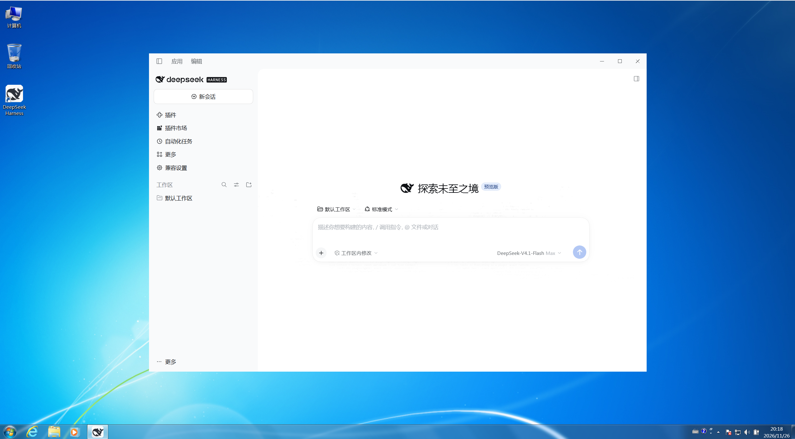
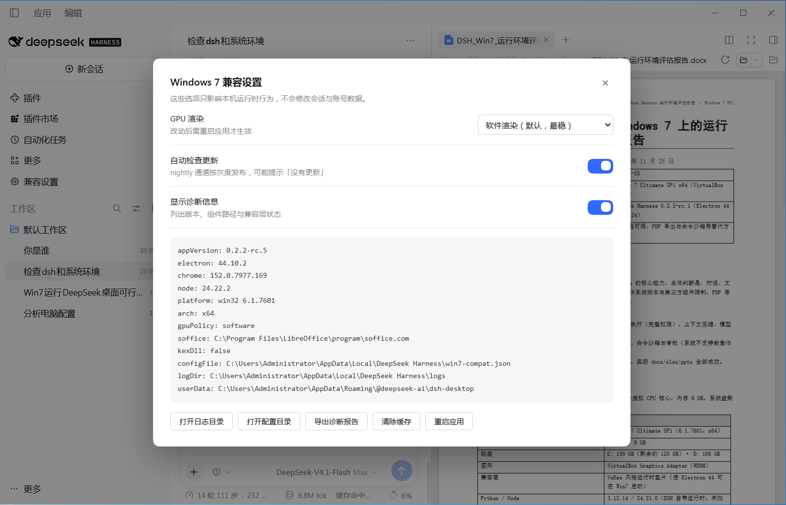
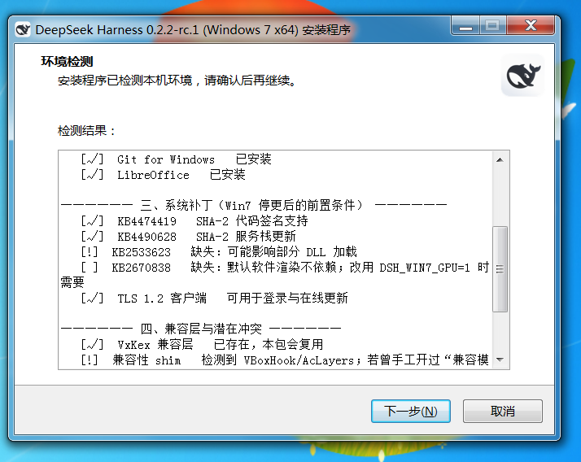
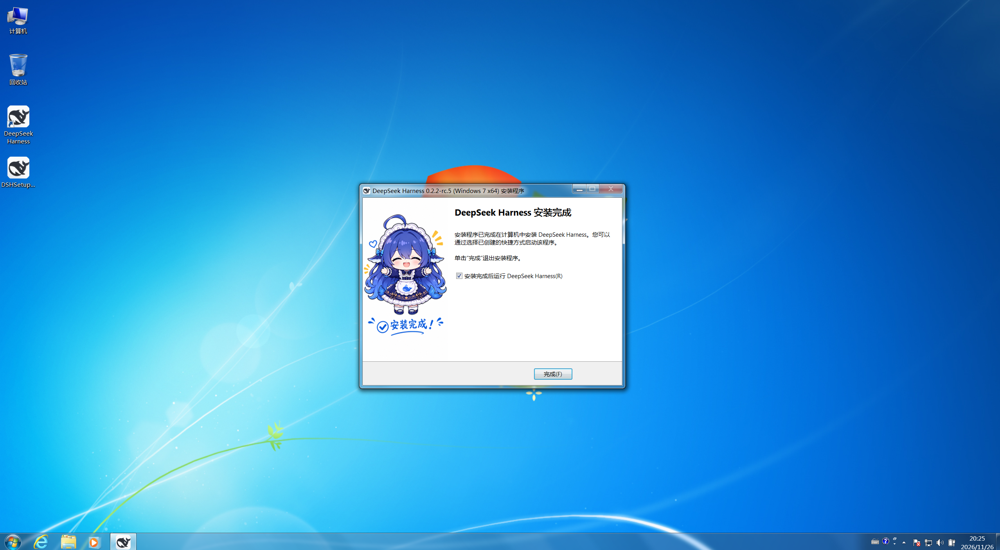

<div align="center">

# DeepSeek Harness Desktop for Windows 7

**Windows 7 SP1 x64 · Port v1.0.0 · Based on DeepSeek Harness Desktop 0.2.2-rc.5**

[Download DSHSetup.exe](https://github.com/XHZZZY/DeepSeek-Harness-Desktop-Win7/releases/download/main/DSHSetup.exe) · [Release notes](https://github.com/XHZZZY/DeepSeek-Harness-Desktop-Win7/releases/tag/main) · [简体中文](README.md)

</div>

This is a community port I made in my spare time so DeepSeek Harness Desktop can run on Windows 7. The installer includes the desktop runtime and compatibility components. Choose the components you need in the setup wizard.

[](docs/images/desktop.png)

## 📦 Download and install

Run [DSHSetup.exe](https://github.com/XHZZZY/DeepSeek-Harness-Desktop-Win7/releases/download/main/DSHSetup.exe) on **Windows 7 SP1 x64** and follow the setup wizard. Select LibreOffice if you want to preview Office documents or export PDFs.

The English and Chinese setup wizard checks the Windows version, updates, TLS 1.2, VxKex, and local tools. It offers .NET Framework 4.8, PowerShell 5.1, and optional copies of Git, 7-Zip, and LibreOffice 7.3.7.2. Setup also shows both versions during an upgrade and lets you choose whether to launch the app at sign-in.

<details>
<summary>Windows 7 updates offered by the installer</summary>

| Update | Purpose |
| --- | --- |
| KB4490628 | Updates the servicing stack so later updates can be installed |
| KB4474419 | Adds SHA-2 code-signing support |
| KB2533623 | Adds APIs that some programs use to load DLLs |
| KB2670838 | Updates graphics components such as Direct2D and DirectWrite |

</details>

## What works on Windows 7

| Feature | Details |
| --- | --- |
| Workspaces and chats | Start chats, choose workspaces, and reference files with @. Plugins and automations are available in the sidebar. |
| Local tools | Use the `dsh` command, plugins, Node.js, and Python. The bundled Node.js and Python use VxKex. File search uses ripgrep 13.0.0. |
| Office previews and PDFs | When the built-in converter fails to load on Windows 7, the app uses LibreOffice's `soffice.com` to make a PDF and opens it in the preview panel. The installer also provides `office-pdf.cmd` for direct conversion. |
| Compatibility settings | Check runtime versions, rendering mode, and the LibreOffice path. You can also open the log folder, export a diagnostic report, clear the cache, or restart the app. |

## 🖥️ Screenshots

I tested the app in VirtualBox with Windows 7 Ultimate SP1 x64, two virtual CPUs, and 8 GB of RAM. A three-page Chinese Word document converted successfully and all pages appeared in the preview panel.

[](docs/images/compat-settings.png)

<details>
<summary>See the setup wizard</summary>

[](docs/images/installer-check.png)

[](docs/images/installer-finish.png)

</details>

## Windows 7 notes

- **In-app updates** are off by default. Triggering an update closed the app in testing, and the upstream build cannot run on Windows 7. Check this project's Releases page for updates.
- **Software rendering** is on by default to reduce blank windows with older graphics hardware and in virtual machines. You can try hardware acceleration in Compatibility Settings.
- **Restricted sandbox mode** is unavailable on Windows 7. Commands launched by the app run with the current user's permissions.
- **Plugin marketplace** is optional. Enter `market` on the Plugins page or run `dsh plugin --profile web add dshmarket` in PowerShell. [Marketplace project](https://github.com/dsh-market/dsh-market)
- **Other versions of Windows**, including Windows 8.1, are outside this port's current scope. You can request support in Issues.

## 🛠️ Build from source

Download [dsh-win7-repo.zip](dsh-win7-repo.zip) and extract it.

Use a **Windows 10/11 x64** build machine with PowerShell 5.1 or later, Python 3.9 or later, [7-Zip](https://www.7-zip.org/), and [Inno Setup 6.7.4](https://jrsoftware.org/isdl.php). Optionally, use `rcedit-x64.exe` to set the icon and version metadata.

Run these commands from the extracted directory containing `scripts`.

```powershell
# Full build
.\scripts\build.ps1

# Reuse previously downloaded build inputs
.\scripts\build.ps1 -SkipFetch

# Use a local Electron archive and upstream installer
.\scripts\build.ps1 -RuntimeZip D:\electron-v44.10.2-win32-x64.zip -PayloadExe D:\dsh-setup.exe
```

The build outputs `build\output\DeepSeekHarness-win7-x64-Setup.exe`, about 1.1 GB. The build archive contains patches, added source files, and the installer configuration. The scripts fetch the upstream binaries.

<details>
<summary>Build steps and compatibility changes</summary>

1. Fetch `electron-legacy 44.10.2` and the upstream installer, then check Electron's PE subsystem version.
2. Unpack the upstream installer with 7-Zip, extract `app.asar`, and apply the diffs in `patches/`.
3. Update the native addon's V8 marker and Node version tuple, then rebuild `app.asar`. Any additional native addons need to match Electron 44's ABI.
4. Replace the runtime, assemble the compatibility files, prerequisites, and installer configuration from `files/`, verify the result, and package it with Inno Setup.

The upstream Electron binary has PE subsystem version 10.0, which Windows 7 cannot load. This port uses [electron-legacy](https://github.com/Alex313031/electron-legacy), draws its own title bar, and uses VxKex for APIs needed by the bundled Node.js and Python. It uses a system LibreOffice installation for Office conversion.

</details>

## 💬 Feedback and project notes

If you hit a problem, export a diagnostic report from Compatibility Settings and include your Windows version and steps to reproduce it in [Issues](https://github.com/XHZZZY/DeepSeek-Harness-Desktop-Win7/issues). You can also email `mini.myqq@gmail.com`. The development notes are in [Develop.md](Develop.md) (Chinese).

This is a community port. Upstream components retain their own licenses, listed in `files/licenses/THIRD-PARTY-NOTICES.txt` in the build archive. The build downloads VxKex separately. The added compatibility code does not collect or upload API keys, tokens, or session data. See `files/licenses/PRIVACY-WIN7.zh.txt` for details.

I put this together in my spare time during my first year of university. If it helps you keep using DeepSeek Harness on Windows 7, a Star is welcome ⭐.
