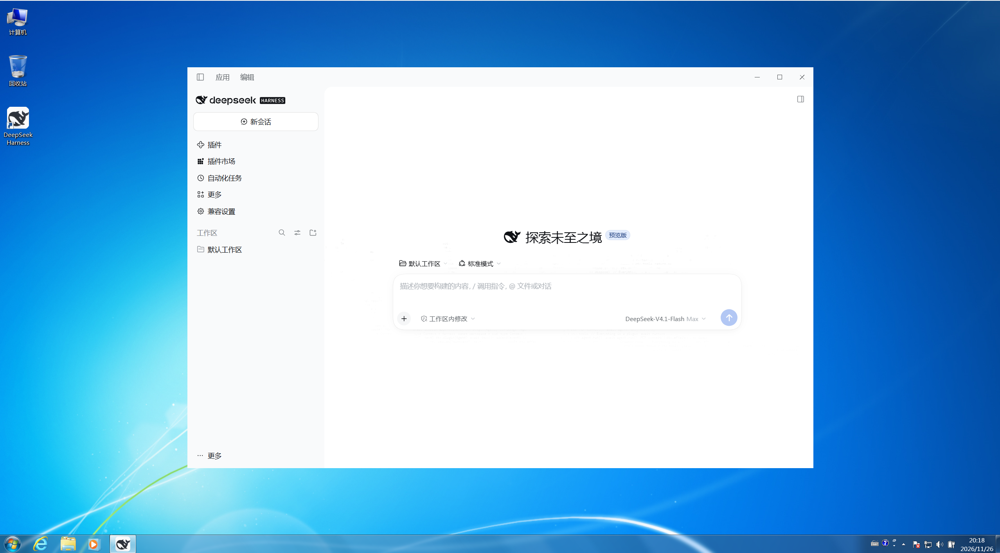
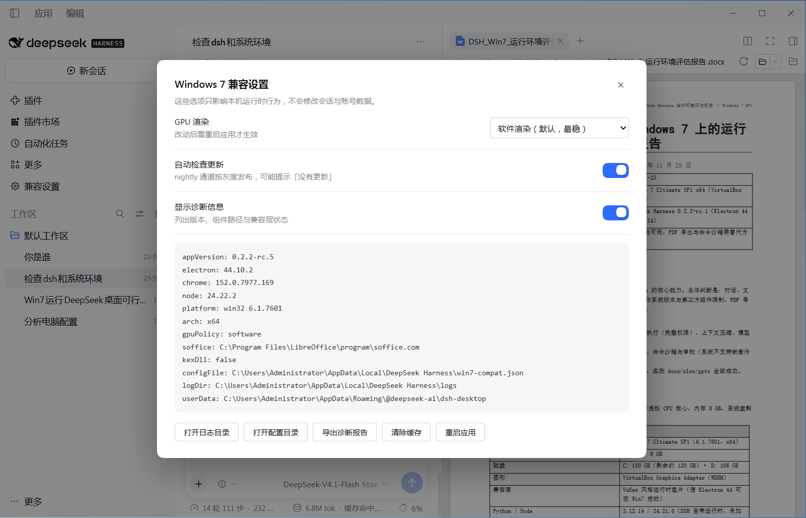
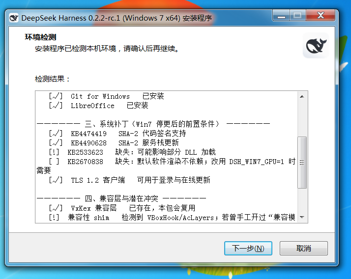

# DeepSeek Harness Desktop · Windows 7 兼容版

**Windows 7 SP1 x64** · **兼容版 v1.0.0** · **基于 DeepSeek Harness Desktop 0.2.2-rc.5**

[下载地址](https://github.com/XHZZZY/DeepSeek-Harness-Desktop-Win7/releases/download/v1.0.0/DSHSetup.exe)　·　[查看发行说明](https://github.com/XHZZZY/DeepSeek-Harness-Desktop-Win7/releases/tag/v1.0.0)

这个项目让仍在使用 Windows 7 的电脑也能运行 DeepSeek Harness 桌面端。打开工作区，就可以在对话中引用本地文件，让 DSH 处理文档，再在同一个窗口里查看结果，使用体验与原版没有较大差别。这个社区适配版把桌面运行时、Windows 7 兼容组件和安装向导打在同一个安装包里。

## 在 Windows 7 上能做什么

| 功能 | 使用方式与完成情况 |
| --- | --- |
| 工作区与对话 | 在桌面端新建会话，选择工作区，用 `@` 引用文件。侧栏可以切换会话，也保留了插件和自动化任务入口。 |
| 原生功能修复 | 功能已经完全修复，包括使用DSH命令、下载、使用插件和使用Python等工具。 |
| Office 预览与 PDF | 在内置转换器无法处理文件时，调用本机 LibreOffice 生成 PDF，交回应用预览。开发实测中，一份三页中文报告完整显示。也可以用随包的 `office-pdf.cmd` 直接将文档转为 PDF。 |
| 本地工具 | 安装器为随附的 Node.js 和 Python 配置 VxKex（感谢开源社区的贡献🎉），文件搜索采用 ripgrep 13.0.0。`dsh` 命令安装到当前用户可写的目录，可以在应用里管理。 |
| 兼容设置与诊断 | 在侧栏添加了「兼容设置」，方便查看渲染策略、更新开关、运行时版本及 LibreOffice 路径。面板还可打开日志目录、导出诊断报告、清理缓存和重启应用。 |

## 相比原版它改了什么

**桌面运行时。** 将 Electron 替换为可在 Windows 7 加载的 `electron-legacy 44.10.2`，并让原生 Node 模块与这套运行时匹配。实测面板显示 Chromium `152.0.7977.169`、Electron 内置 Node.js `24.22.2`，系统为 `6.1.7601 x64`。

**窗口与渲染。** 旧显卡和虚拟机显卡上曾出现窗口已打开、内容却全白的问题。本版默认使用软件渲染。主窗口改用自绘标题栏，在 Windows 7 上也能最小化、最大化、还原和关闭，任务栏与托盘使用应用自己的图标。

**文档转换。** 针对原版 Office 转换进程在 Windows 7 上启动失败的问题，接入 LibreOffice 的命令行程序 `soffice.com`。兼容层接收转换结果，将 PDF 放回桌面端预期的位置，因此文档仍然在原来的预览面板中打开。

**安装与维护。** 中英文安装向导会检测系统版本、补丁、TLS 1.2、VxKex 和工具链。安装包提供 .NET Framework 4.8、PowerShell 5.1，以及可选的 Git、7-Zip 和 LibreOffice 7.3.7.2。四项系统补丁也可在向导中选择。覆盖安装时，向导会显示已装版本和目标版本。

查看安装向导提供的四项 Windows 7 补丁

| 补丁 | 在向导中的用途 |
| --- | --- |
| KB4490628 | 为后续系统更新提供服务堆栈支持 |
| KB4474419 | 增加 SHA-2 代码签名支持 |
| KB2533623 | 提供部分程序加载 DLL 时使用的接口 |
| KB2670838 | 更新 Direct2D、DirectWrite 等图形组件 |

## Windows 7 系统环境下实测

测试环境为 VirtualBox 中的 Windows 7 旗舰版 SP1 x64，分配 2 个虚拟 CPU 和 8 GB 内存。系统为官方原版，未进行任何改动。

### 兼容设置与文档预览

前台面板显示当前软件渲染策略、运行时版本和 `soffice.com` 路径。图片中的Word报告为PDF转换测试

### 从环境检测到安装完成

内置系统环境检测，并以列表形式告诉你缺了什么，并且已经内置了需要的系统补丁、兼容层及套件。

下图为完成安装后的画面。安装过程中提供开机自启（可选）。

[!安装完成，向导提供立即启动 DeepSeek Harness 的选项。](docs/images/installer-finish.png)](docs/images/installer-finish.png)

## 下载 v1.0.0

下载 [DSHSetup.exe](https://github.com/XHZZZY/DeepSeek-Harness-Desktop-Win7/releases/download/v1.0.0/DSHSetup.exe)，在 Windows 7 SP1 x64 上运行，按向导选择组件。需要在应用内预览 Office 文档或导出 PDF 时，选择包含 LibreOffice 的工具链组件。
## 提示

不要在应用内检查更新（默认已关闭，可手动打开），经过实测，点击更新只会退出DeepseekHarnessDesktop,更新软件无法正常在windows7下运行，所以意义不大。
因为兼容层的原因，有可能会出现GPU进程崩溃的问题，所以默认走的是软件渲染，你可以在「兼容设置」中选择渲染模式（支持硬件加速选项）。
默认不携带任何第三方插件，图片中的插件市场只是为了测试插件功能是否正常，如需安装。可以在插件页面输入market即可安装插件市场，或者在PowerShell中输入dsh plugin --profile web add dshmarket
插件市场项目地址：https://github.com/dsh-market/dsh-market
目前软件只兼容windows7，其它系统无法安装，如果其它系统如windows8.1等用户数量较多，可以提交issues，如果人多且有时间那么我将进行适配。
开发历程可以在Develop.md中查看。

## 反馈

如果你在使用中遇到什么问题或错误，请携带日志（兼容选项页面中）提交issues，或者直接向mini.myqq@gmail.com发邮件反馈~
## 闲谈

这是一个大一学生在课余时间用大肥鱼花费10亿tokens做的项目（GPTplus额度太少蹬不动，哭），如果这个项目对在windows7上怀旧或者设备无法支持运行高版本系统的你有所帮助，那么就帮我点一颗免费的 **Star ⭐**。
最后声明，除官方DeepseekHarnessDesktop的组件需要联网外（包括electron的兼容版组件），针对兼容所做的任何改动都不会进行联网操作，因此您不必担心您的APIkey和登录状态被泄露上传。

