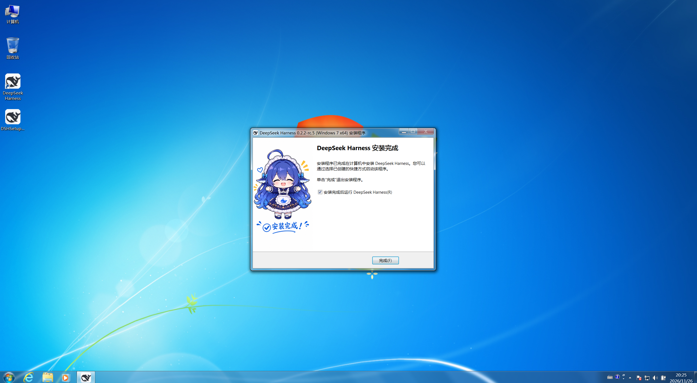

<div align="center">

# DeepSeek Harness Desktop · Windows 7 兼容版

**Windows 7 SP1 x64 · 兼容版 v1.0.0 · 基于 DeepSeek Harness Desktop 0.2.2-rc.5**

[下载 DSHSetup.exe](https://github.com/XHZZZY/DeepSeek-Harness-Desktop-Win7/releases/download/main/DSHSetup.exe) · [发行说明](https://github.com/XHZZZY/DeepSeek-Harness-Desktop-Win7/releases/tag/main) · [English](README.en.md)

</div>

这是我在课余做的 Windows 7 社区适配版，让还在用 Windows 7 的电脑也能运行 DeepSeek Harness 桌面端。安装包自带桌面运行时、兼容组件和安装向导，按需勾选组件即可。

[](docs/images/desktop.png)

## 📦 下载与安装

在 **Windows 7 SP1 x64** 上运行 [DSHSetup.exe](https://github.com/XHZZZY/DeepSeek-Harness-Desktop-Win7/releases/download/main/DSHSetup.exe)，按向导选择需要的组件。需要预览 Office 文档或导出 PDF 时，勾选 LibreOffice。

安装向导支持中英文，会检查系统版本、补丁、TLS 1.2、VxKex 和工具链。安装包提供 .NET Framework 4.8、PowerShell 5.1，以及可选的 Git、7-Zip 和 LibreOffice 7.3.7.2。覆盖安装时会显示已装版本和目标版本，也可以选择开机启动。

<details>
<summary>安装向导提供的 Windows 7 补丁</summary>

| 补丁 | 用途 |
| --- | --- |
| KB4490628 | 更新服务堆栈，为安装后续补丁做准备 |
| KB4474419 | 提供 SHA-2 代码签名支持 |
| KB2533623 | 提供部分程序加载 DLL 时需要的接口 |
| KB2670838 | 更新 Direct2D、DirectWrite 等图形组件 |

</details>

## Windows 7 上可以用什么

| 功能 | 说明 |
| --- | --- |
| 工作区与对话 | 新建会话、选择工作区、用 @ 引用文件。侧栏保留插件和自动化任务入口。 |
| 本地工具 | 可以使用 `dsh` 命令、插件、Node.js 和 Python。随附的 Node.js 和 Python 依赖 VxKex，文件搜索使用 ripgrep 13.0.0。 |
| Office 预览和 PDF | 内置转换器在 Windows 7 上无法加载时，应用会调用 LibreOffice 的 `soffice.com` 生成 PDF，再交回预览面板。也可用随包的 `office-pdf.cmd` 转换。 |
| 兼容设置 | 可查看运行时版本、渲染方式和 LibreOffice 路径，也能打开日志目录、导出诊断报告、清理缓存和重启应用。 |

## 🖥️ 实测截图

测试环境为 VirtualBox 中的 Windows 7 旗舰版 SP1 x64，分配了 2 个虚拟 CPU 和 8 GB 内存。实测中，一份三页的中文 Word 报告成功转换并完整显示在预览面板里。

[](docs/images/compat-settings.png)

<details>
<summary>查看安装向导截图</summary>

[](docs/images/installer-check.png)

[](docs/images/installer-finish.png)

</details>

## Windows 7 上需要注意的地方

- **应用内更新**默认关闭。实测触发更新会退出应用，上游版本无法在 Windows 7 上运行。更新时请查看本项目的发行页面。
- **渲染**默认使用软件模式，以减少旧显卡或虚拟机上的白屏问题。可在「兼容设置」中尝试开启硬件加速。
- **受限沙箱**在 Windows 7 上不可用。应用启动的命令以当前用户权限运行。
- **插件市场**需要自行安装。可在插件页输入 `market`，或在 PowerShell 运行 `dsh plugin --profile web add dshmarket`。[插件市场项目](https://github.com/dsh-market/dsh-market)
- **其他系统**如 Windows 8.1 暂未适配，可在 Issues 中提出需求。

## 🛠️ 从源码构建

下载构建包 [dsh-win7-repo.zip](dsh-win7-repo.zip)，解压到本地。

构建机使用 **Windows 10/11 x64**，需要 PowerShell 5.1 或更新版本、Python 3.9 或更新版本、[7-Zip](https://www.7-zip.org/) 和 [Inno Setup 6.7.4](https://jrsoftware.org/isdl.php)。可选用 `rcedit-x64.exe` 写入图标和版本信息。

在解压后包含 `scripts` 的目录运行以下命令。

```powershell
# 完整构建
.\scripts\build.ps1

# 使用已下载的构建材料
.\scripts\build.ps1 -SkipFetch

# 指定本地 Electron 压缩包和上游安装程序
.\scripts\build.ps1 -RuntimeZip D:\electron-v44.10.2-win32-x64.zip -PayloadExe D:\dsh-setup.exe
```

构建产物位于 `build\output\DeepSeekHarness-win7-x64-Setup.exe`，约 1.1 GB。构建包包含补丁、新增源码和安装器配置，上游二进制文件由构建脚本获取。

<details>
<summary>构建流程与主要改动</summary>

1. 下载 `electron-legacy 44.10.2` 和上游安装包，检查 Electron 的 PE 子系统版本。
2. 用 7-Zip 解包上游安装程序，提取 `app.asar` 并应用 `patches/` 下的补丁。
3. 调整原生扩展的 V8 版本标记和 Node 版本元组，再重建 `app.asar`。其他原生扩展也需要与 Electron 44 的 ABI 匹配。
4. 替换桌面运行时，组装 `files/` 中的兼容代码、前置组件和安装器配置，验证后用 Inno Setup 打包。

上游 Electron 的 PE 子系统版本为 10.0，Windows 7 无法加载，因此这里换成 [electron-legacy](https://github.com/Alex313031/electron-legacy)。窗口改用自绘标题栏，随附 Node.js 和 Python 通过 VxKex 使用 Windows 7 缺少的 API，Office 转换则调用系统 LibreOffice。

</details>

## 💬 反馈与项目说明

遇到问题时，可从「兼容设置」导出诊断报告，附上系统版本和复现步骤，提交 [Issues](https://github.com/XHZZZY/DeepSeek-Harness-Desktop-Win7/issues)，也可以发邮件到 `mini.myqq@gmail.com`。开发过程记在 [Develop.md](Develop.md)。

这是社区适配版。上游组件沿用各自的许可，详见构建包内的 `files/licenses/THIRD-PARTY-NOTICES.txt`。VxKex 由脚本单独下载。项目新增的兼容代码不会收集或上传 API 密钥、令牌和会话数据，详见 `files/licenses/PRIVACY-WIN7.zh.txt`。

这是我大一课余折腾出来的项目。如果它帮你在 Windows 7 上继续用 DeepSeek Harness，欢迎点个 Star ⭐。
